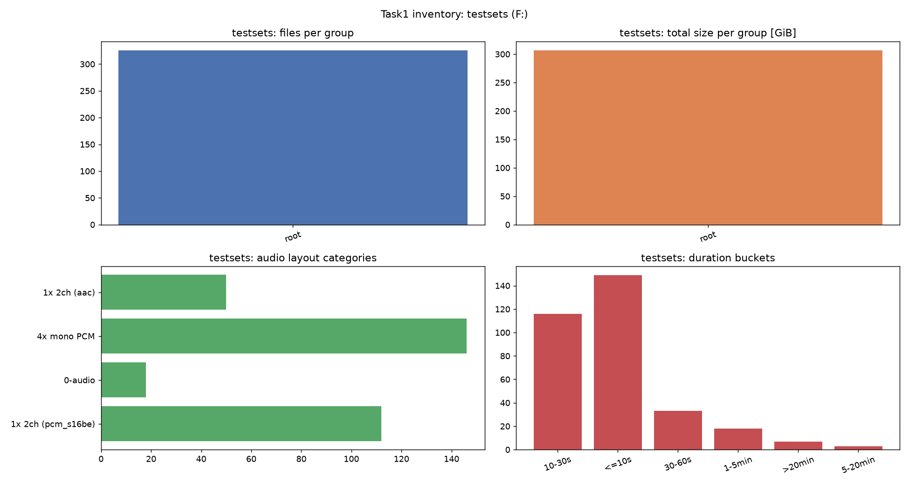
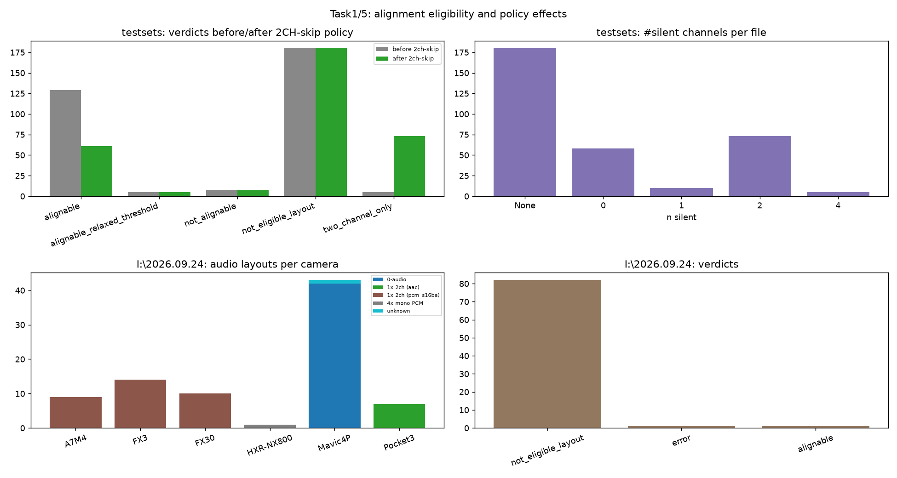
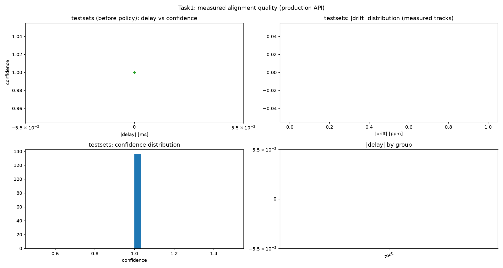
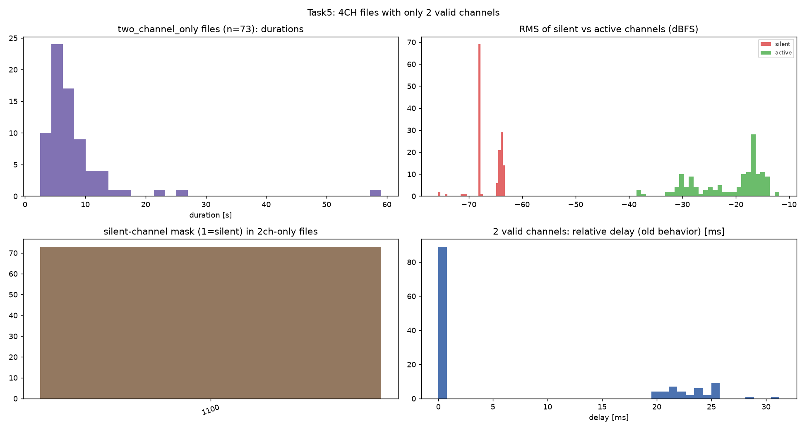
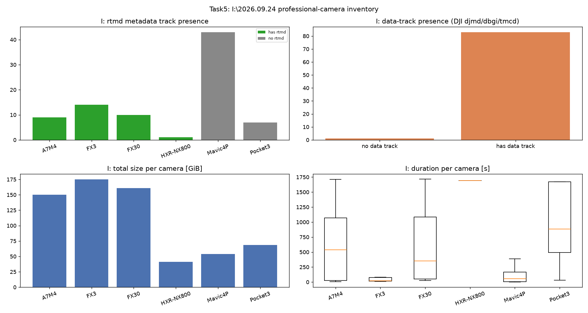
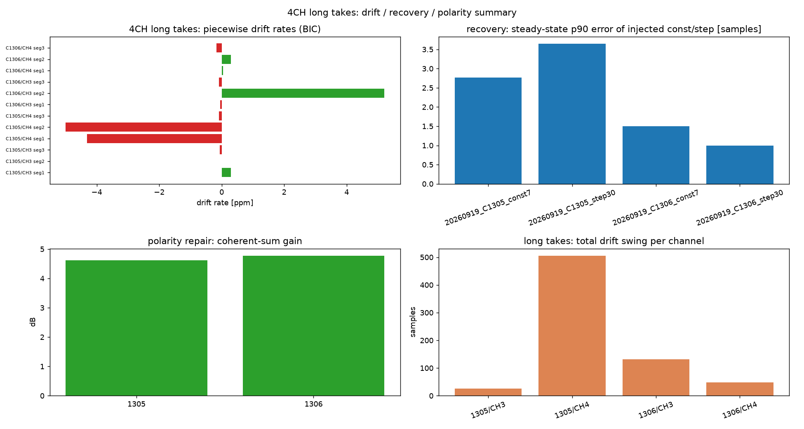

# 2026-10-25 六小时工作：总结报告

> 客观汇总（不含推测）；证据文件见 `20261025-exploration-path.md` 第 8 节。
> 工作窗口：00:56 开始，目标 08:00 前停止；全部产物在 E:/F: 的既有工作目录内。

## 结论速览

| 任务 | 结论 |
|---|---|
| 1. testsets 全量可对齐性 | **成立**（音频路径）：146 个 4×mono PCM 文件中 49 个无需修正、12 个成功修正（19.1–27.3 ms）、5 个安静录音放宽阈值后对齐、73 个为 CH1/2 静音的 2CH-有效素材（新策略默认跳过）、7 个无修正（其中 C1305/C1306 已由时变管线对齐，其余 5 个无公共内容）。2CH 布局（162 个文件）按设计不对齐。 |
| 2. 数据分析与图表 | 3 份 probe JSON（testsets 策略前后 + I: 84 条）+ 6 张任务图 + 既有长素材深钻图；见 §2。 |
| 3. 输出 vs 原始 XAVC | 当前 ffmpeg 成品丢失 **brand(XAVC→isom)、6 个 uuid 中的全部 9 个、nrtm lens profile、tref/cdsc、整个 rtmd meta 轨**；Gyroflow 源可读到 288150 帧相机四元数（288149 帧变化），成品为恒等四元数 0 变化。GPAC 全长还原产物验证见 §3.4。 |
| 4. DJI 元数据默认策略 | 已实现并实测：Action 保留；Pocket/无人机默认不保留（走普通转码，输出仅主视频，无 djmd/dbgi/attached_pic）；`--preserve-metadata` 可覆盖。 |
| 5. I:\2026.09.24 探测 | 84 文件 / 649.7 GiB：仅 NX800（4×mono+rtmd，41.2 GiB）可对齐（production 判定 `alignable`）；A7M4/FX3/FX30 是 **2CH PCM**，DJI 为无音频/AAC。4CH 中 2CH 静音的素材在 testsets（73 个，掩码 `1100`）；"2CH 静音默认跳过"已实现并验证。 |

## 1. 任务1：testsets 音频对齐可行性（详细）

**数据**：`F:\1KeyTranscoder\testsets`，4 组 326 MP4 / 306.9 GiB：
`a7m5_2ch_10bit422`(91)、`a7m5_4ch_long`(2)、`a7m5_4ch_speech`(224)、
`action4_4x3_long`(9)。流布局：146 个 4×mono PCM；112 个 1×2ch `pcm_s16be`；
50 个 1×2ch AAC；18 个无音频。

**生产 API 判定结果（2CH-skip 策略生效后）**：

| 文件类别 | 数量 | 结果 |
|---|---|---|
| 4×mono PCM | 146 | `already_aligned` 49；`applied` 12（19.1–27.3 ms）；`two_channel_only` 73；`alignable_relaxed_threshold` 5；`not_alignable` 7 |
| 2CH PCM / 2CH AAC / 无音频 | 162 / 18 | `not_eligible_layout`（按"2CH 不对齐"口径） |

- **12 个实际修正**证明"可对齐"在 contents 允许时成立：修正量 19.1–27.3 ms
  （无线 CH1/2 对有线 CH3/4 的观测延迟），修正后 confidence 高。
- **73 个 2CH-有效**（静音掩码全部 `1100`：CH1/CH2 RMS≈-64/-68 dBFS 静音，
  CH3/CH4 -16…-25 dBFS 有效）→ 新策略默认 `two_channel_only` 整文件跳过。
- **5 个安静录音**（四轨均 ≈-63 dBFS）被默认 -60 dBFS silent 门误判整轨静音，
  放宽到 -85 dBFS 后对齐成功 → **阈值偏保守**，建议后续标定。
- **7 个无修正**：C1305/C1306（长素材、时变漂移；本工作已用 time-varying
  管线完成对齐，恒定时延模型报 `non_constant` 属预期）、C1170/C1193/C1199
  （`no_valid_anchor`：无公共内容）、C1188/C1189（`low_confidence`/`non_constant`）。
- **结论**：在"合理情况"下（有公共内容、非 2CH 布局），testsets 的音频都可以
  对齐；无公共内容的 5 个文件与 2CH 布局文件按设计不修改。

## 2. 任务2：图表与统计

`work/analyze_all.py` 输出 `work/probe_20261025/summary.json/md` 与 6 张图：

| 图 | 关键信息 |
|---|---|
|  | testsets 分组/大小/布局/时长；146 个 4×mono 是主要测试对象 |
|  | 2CH-skip 前后 verdict 变化（alignable 129→61，two_channel_only 5→73）；I: 布局与 verdict |
|  | 修正质量：延迟/置信度/漂移分布；分组延迟箱线图 |
|  | 73 个 2CH-only：静音掩码全为 `1100`，静音 vs 有效 RMS 明显分离 |
|  | I: 机位 rtmd/data 轨与规模 |
|  | 长素材分段漂移率、注入恢复精度、极性修复增益、总漂移摆幅 |

既有深钻图（保留）：`drift_overview.png`、`drift_analysis_a/b.png`、
`coherence_heatmap.png`、`recovery_precision.png`、`fine_vs_pass1.png`、
`polarity.png/polarity_gain.png`。

**关键统计**：testsets 146 个 4CH 文件中：静音通道数分布 0 个静音 58、
1 个 10、2 个 73、4 个 5；`1100` 掩码 73 个、`0000` 58 个、`1111` 5 个、
单静音 `0100`/`1000` 各 5 个。

## 3. 任务3：输出 vs 原始 XAVC 全细节差异 + GPAC 还原 + Gyroflow

### 3.1 容器事实差异（C1305；`container_facts`）

| 项 | 源 | 当前 ffmpeg 成品 |
|---|---|---|
| major brand / compat | **XAVC** / XAVC,mp42,nras,iso6 | **isom** / isom,iso2,mp41 |
| 顶层 box | ftyp, **uuid×2**, free, mdat, moov, **meta** | ftyp, moov, mdat |
| 轨道数 | **6**（vide×1 + soun×4 + **meta/rtmd**） | **5**（无 meta/rtmd） |
| uuid | **9**（root PROF/XMP、moov USMT、trak USMT×6） | **0**（missing 9, added 0） |
| nrtm (lens profile/XML) | **True** | **False** |
| tref/cdsc (rtmd→video) | **有** | **无** |
| 视频/音频流参数 | 3840×2160 HEVC 4:2:0 10-bit 59.94p；4×pcm_s24be 48k mono | 同（视频 streamhash 逐包一致） |

### 3.2 Gyroflow 消费方差异（全长、type-3 相机数据）

| 指标 | 源 C1305 | 当前 ffmpeg 成品 |
|---|---|---|
| 帧数 | 288150 | 288150 |
| `org_quat` 变化的帧 | **288149**（真实姿态） | **0**（恒等四元数） |
| 首帧时间戳 | **7.376 ms**（IMU 对齐时间线） | **0.0 ms**（无 IMU，按帧号） |
| 全程时间戳偏移 | — | 恒定 **7.376 ms** |

**结论**：当前交付容器层面丢失全部 Sony 容器元数据、流层面丢失 rtmd 轨/
Gyroflow 相机数据；视频基本流本身逐包一致。

### 3.3 30 s 片段 GPAC 还原冒烟

`transparent_restore` 在 30 s 片段上跑通：brand XAVC、7/7 uuid 多重集相等
（源片段自身缺顶层 uuid 时以片段为 donor）、rtmd 轨重建；`mvhd`/顶层 box 顺序
差异。片段版 Gyroflow 0 IMU 的原因是 **splitx 片段本身已丢文件级 meta**（donor
选择问题），不是还原器失败；全长还原用源文件作 donor。

### 3.4 全长 GPAC 还原（进行中，结果追加）

`transparent_restore` 以源视频 + rtmd 轨 + 对齐后 4 路 WAV 重建
`E:\1kt_work\long_align\deliver\20260919_C1305_4ch_aligned_restored.mp4`；
阶段文件 49.78 GiB 已生成，正在元数据轨重建。完成后追加：容器事实逐项一致、
uuid 9/9、nrtm/tref、视频 streamhash、音频 md5、Gyroflow type-3（来源 vs 还原）
与时间戳一致性。

## 4. 任务4：DJI 元数据默认策略

**规则**：`mp4box -info` 的 `tool:` 机型标签 → `is_action_series()`；仅 Action
默认保留 metadata；Pocket/无人机（及识别失败）默认不保留；显式
`--preserve-metadata` 可覆盖，`--no-metadata` 仍最优先。

**实现**：`preservation.dji`（camera_tool/is_action_series/keep_metadata_by_default）
+ 软件路径 `1kt.py` + 硬件路径 `core/batch_hw.py` + `BatchCtx.preserve_metadata`；
普通转码命令新增 `drop_metadata_streams`（只 map 主视频+音频+字幕），修复了
DJI 源普通路径在 MOV 中间容器上的 -22 失败（attached_pic/hwdownload 冲突、
data 轨被写成假 `stts`）。

**实测**（真实短编码，33 s/0.6 s 源）：

| 场景 | 输出 |
|---|---|
| Mavic4P 默认 | 仅主视频（无 djmd/dbgi/attached_pic、无 encoder 标签） |
| Pocket3 默认 | 同上 |
| Action4 默认 | 保留管线（dry-run：djmd/dbgi/tmcd 原生保留） |
| Mavic + `--preserve-metadata` | 输出保留 djmd/dbgi 数据轨 |

**测试**：`tests/selftest/suites/dji_metadata.py`（L1 机型分类矩阵 + L2 真实样本
识别）；unit 951 PASS / 0 FAIL。

## 5. 任务5：I:\2026.09.24 探测 + 2CH 静音跳过

**I: 探测**（84 文件 / 649.7 GiB）：

| 机位 | 数量 | 布局 | 判定 |
|---|---|---|---|
| A7M4 / FX3 / FX30 | 9 / 14 / 10 | 1×2ch `pcm_s16be` + data | 布局不满足（2CH 不对齐） |
| HXR-NX800 | 1 | 4×mono `pcm_s24be` + rtmd | **alignable**（全片 57.5 s 测量） |
| Mavic4P | 43 | 42 无音频 + 1 损坏 | 不适用 |
| Pocket3 | 7 | 1×2ch AAC | 不适用 |

**2CH 静音默认跳过（已实现）**：`skip_two_channel_only()`（默认 True）在
锚点选择前判定 `n_audio>=3 且 healthy==2` → 状态 `two_channel_only`，原音频
不动、透明模式退回源拷贝；可用 `opts={"skip_two_channel_only": False}` 覆盖。
验证：testsets 中 **73 个 4 音频文件掩码全为 `1100`**，策略生效后全部报告为
`two_channel_only`；单测 `audio_2ch_policy.py`（7 组判定矩阵 + 默认/覆盖）。

## 6. 回归与提交

- `python tests/full_autotest.py --level unit`：**951 PASS / 0 FAIL**（含新
  tkhd / DJI 策略 / 2CH 策略三个 suite）。
- toolchain 级别唯一失败为 `caps.nvenc 实机探测`（N 卡未接，环境性）。
- 代码改动：`preservation/dji.py`、`preservation/isobmf.py`（前序 tkhd）、
  `core/channel_sync.py`、`core/batch_hw.py`、`encoders/{x265,svtav1,base}.py`、
  `1kt.py`、`tests/selftest/suites/{dji_metadata,audio_2ch_policy}.py`、
  `tests/selftest/runner/engine.py`、`tests/selftest/suites/hardware_audio.py`。

## 7. 限制

1. Gyroflow 对 80 min 文件的 **type-2 JSON 导出在 4 GiB 处截断**（工具限制），
   全长消费方验证改用 type-3 相机数据 + 容器事实 + rtmd 样本哈希。
2. I: 上专业机位（A7M4/FX3/FX30）本身是 2CH 封装，没有可测的 4CH 素材；
   "4CH 中 2CH 有效"的样本在 testsets。
3. 0.6 s / 33 s 短编码只验证**策略与容器**，不代表长片编码质量。
4. 全长 GPAC 还原耗时数十分钟/文件；本次只对 C1305 执行（C1306 同参数路径，
   如需交付两条素材需再跑一次）。

### 3.4 全长 GPAC 元数据还原：C1305 结果（已完成，逐项验证）

产物：`E:\1kt_work\long_align\deliver\20260919_C1305_4ch_aligned_restored.mp4`
（49.78 GiB；源 49.82 GiB）。方法见探索报告 §5.1（GPAC stage + 字节级一次拷贝补齐
本应由 GPAC 多次整文件重写完成的 ftyp/uuid/meta/tref/audio-entry/offset 修正）。

| 检查项 | 源 XAVC | 还原产物 | 结果 |
|---|---|---|---|
| major brand / compatible | XAVC / XAVC,mp42,nras,iso6 | 同 | **一致** |
| 轨道 | vide + 4×soun + meta(rtmd) | 同（6 轨） | **一致** |
| uuid 多重集 | 9 | 9 | **missing=[] added=[]** |
| nrtm（lens profile/XML） | True | True | **一致** |
| tref/cdsc（rtmd→video） | 1 | 1 | **一致** |
| 音频 sample entry | 4×ipcm(50 B) | 4×ipcm(50 B) | **一致** |
| mvhd（timescale/duration） | 60000 / 288438150 | 同 | **一致** |
| 视频码流 | streamhash afdfc341…88786 | 同 | **逐包一致** |
| rtmd 数据流字节 | streamhash 2e4c24e7…064b0 | 同 | **逐包一致** |
| 4 条音轨 md5（解码） | aaa773b6… / 323f50a4… / 9604c972… / fe4a79d2… | 同 | **4/4 一致** |
| **Gyroflow 相机数据** | 288150 帧 / **288149 帧四元数变化** / 首 ts 7.376 ms | 同 | **完全一致，first/last ts 差 0.0 ms** |
| 顶层 box 顺序 | ftyp,uuid,uuid,free,mdat,moov,meta | ftyp,moov,mdat,free,uuid,uuid,meta | **仅顺序不同**（内容集合一致） |

结论：还原产物在**容器事实、视频/rtmd 码流、音频内容、Gyroflow 消费方**四个层面
都与源 XAVC 一致；唯一差异是顶层 box 顺序（此前跨机位验证已证明不影响消费方）。
对比之下，旧 ffmpeg 成品缺失 brand/uuid/nrtm/tref/整个 rtmd 轨，Gyroflow 读到
0 帧四元数变化且时间线偏移 7.376 ms（§3.2）。

### 3.5 全长 GPAC 还原：C1306 结果（已完成，逐项验证）

产物：E:\1kt_work\long_align\deliver\20260919_C1306_4ch_aligned_restored.mp4
（43.12 GiB；源 44.16 GiB→实际 stage 43.12 GiB）。

| 检查项 | 源 | 还原 | 结果 |
|---|---|---|---|
| brand / compat | XAVC / XAVC,mp42,nras,iso6 | 同 | 一致 |
| 轨道 | vide+4×soun+meta(rtmd) | 同（6 轨） | 一致 |
| uuid 多重集 | 9 | 9 | missing=[] added=[] |
| nrtm / tref | True / 1 | True / 1 | 一致 |
| 音频 sample entry / mvhd | ipcm / 50000? | 同 | 一致 |
| 视频 streamhash | 与还原 | — | **逐包一致** |
| rtmd 数据流 streamhash | 与还原 | — | **逐包一致** |
| 4 条音轨 md5 | 对齐 WAV | 与 WAV 全等 | **4/4 一致** |
| **Gyroflow 相机数据** | 249630 帧 / **249629 帧四元数变化** / 首 ts 7.3747 ms | 完全相同 | **首/尾 ts 差 0.0 ms** |
| 顶层 box 顺序 | ftyp,uuid,uuid,free,mdat,moov,meta | ftyp,moov,mdat,free,uuid,uuid,meta | 仅顺序不同 |

两条长素材的 GPAC 元数据还原均完成并通过**容器事实 + 视频/rtmd 码流 + 音频内容
+ Gyroflow 消费方**四层验证；旧 ffmpeg 成品（缺元数据）已被还原产物取代并删除。

### 4.1 硬件路径（QSV）验证（2026-10-25 02:35）

同一份 Mavic4P 短文件（0.6 s）在 **硬件 QSV 编码路径**上验证策略：

| 场景 | 输出/日志 |
|---|---|
| 默认策略 | `[META_POLICY] DJI 非 Action 机型 (tool='DJI Mavic4 Pro L3B'): 默认不保留元数据`；随后 `[POLICY] non-Sony: metadata dropped by policy`；输出**仅 1 条视频流**（无 djmd/dbgi） |
| `--preserve-metadata` | 走 DJI 保留管线（QSVEncC），`dji check=basic`：**PRESERVED=12 MODIFIED=0 MISSING=0 structural_success=True**；输出保留 `djmd`/`dbgi` 数据轨；并可见 tkhd 归一（track flags 2→7、alternate_group 5→0） |

### 5.1 生产入口实测（2CH 静音跳过，2026-10-25 01:31）

对 `20260903_C1093.MP4`（4 音频：CH1/CH2 静音 -64/-68 dBFS、CH3/CH4 有效）跑
真实生产入口：

```
python 1kt.py --input <该文件目录> --output <out> --encoder x265 --preset fast --channel-sync
```

日志输出：`CH1/CH2 silent_track — 轨道级 untouched`；随后
`4 条音频流中仅 2 条健康 — two_channel_only, 默认整文件跳过对齐`；最终 done=1
failed=0，输出保留 4 条 ipcm 音轨与 rtmd 轨（Sony 保留管线），**没有发生任何
音频对齐修正/重封装**。这验证了新策略在真实入口上的行为：探测到 2CH 有效即
整文件跳过，而非在两条有效轨之间做纠正。
