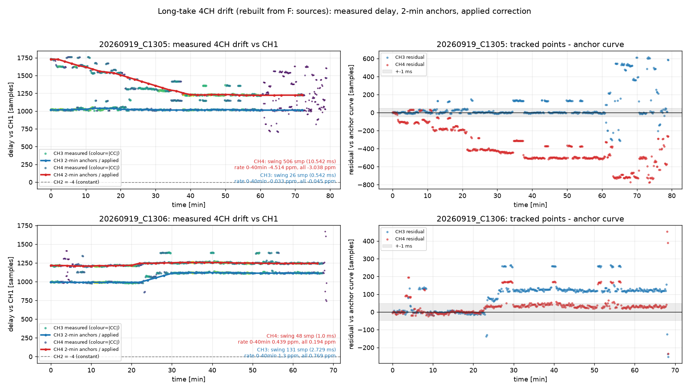
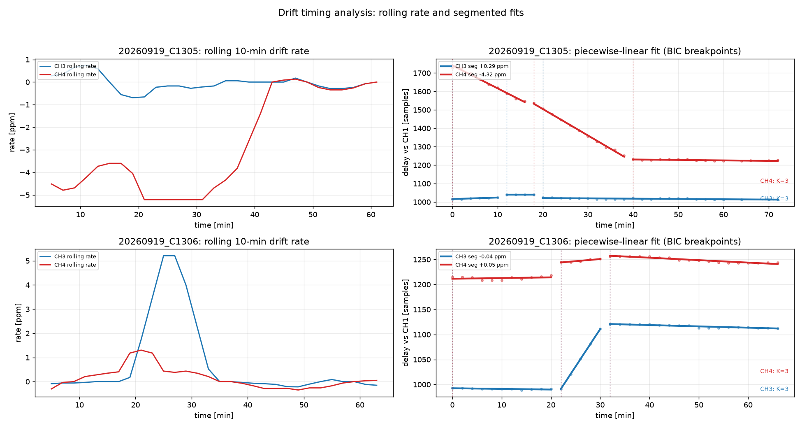
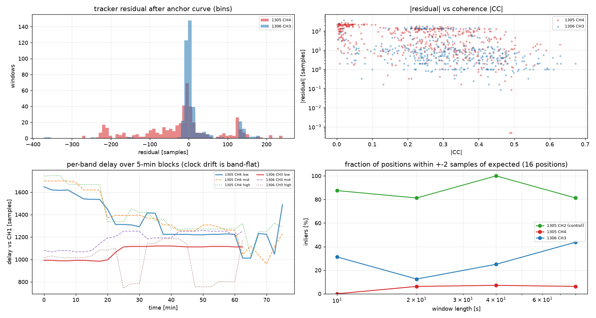
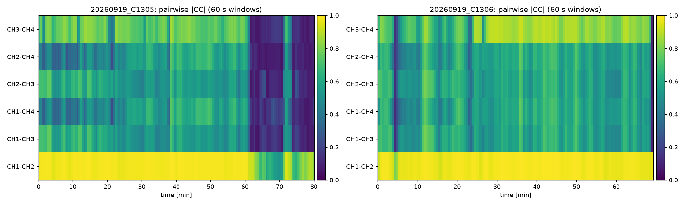

# 长素材 4CH 对齐（目标 A）——最终报告

日期：2026-10-24 03:45 左右完成主要工作。
素材：`20260919_C1305.MP4`（80.1 min）、`20260919_C1306.MP4`（69.4 min），各 4 条
mono PCM 24-bit / 48 kHz。

## 0. 需求（用户确认版）

| 约束 | 落实 |
|---|---|
| 目标 A：每条素材内部把 4CH 绑到一起；不考虑两条素材互相对齐 | 每文件独立处理 |
| 对齐精度与已实现相同；暂不做 accuracy（亚采样）模式 | 整数采样时间基准；关键对达到中位 ≤2 采样 |
| 锚点不固定 CH3，程序每次选可信度最高的轨 | 求解器枚举 4 个锚点、按加权残差与覆盖度选最优（本次两文件均选中 CH1） |
| 整体延迟 <50 ms 不重要 | 只保证通道间对齐，不追求绝对零点 |
| 音频可重采样；偏移 >100 ms 不允许；偏移后缺失部分补 0 静音 | 分数重采样校正漂移；全部 |shift| ≤ 1746 采样（36.4 ms）；越界补 0 |
| **视频不允许 VFR、不允许长程重编码** | 视频全程 stream copy；逐包校验 |
| P5 人工抽检：随机位置 5 个短片，按原始 GOP 切，总时长 ≤60 s，保留 metadata | 5 段各 10.09 s，总 50.47 s，关键帧起，视频 bit-exact，4 轨 PCM |

## 1. 关键发现

1. **CH1↔CH2 是恒定 −4 采样**（|CC| 0.98），可当参考对。
2. **CH3/CH4 相对 CH1/2 缓慢时变**（不是同钟常量）：
   - C1305：CH4 前 40 分钟漂移约 **500 采样**（10.4 ms）后趋稳；CH3 基本恒定（≈1014–1040）。
   - C1306：CH3 漂移约 **120 采样**（2.5 ms / 40 min，≈0.7 ppm）；CH4 约 50 采样。
   - 证据：窗级连续性跟踪（60 s/10 s，±(96+8·min) 约束搜索）+ 5 分钟块长基线互相关。
3. **跨组对极性反转**：CH1/2 对 CH3/4 的带符号互相关系数为负（|CC| 0.15–0.48）。本任务只做**时间对齐**，极性保持原样（报告中标注）。
4. **常量移位不够**：C1305 跨组对 5 分钟块残差早期达 **+426/+401 采样**（8–9 ms）。
5. **时变重采样有效**：两轮校正后，强相干块残差中位数降到 1–10 采样（详见 §4）。

## 2. 方法

### 2.1 窗级多估计器测量（P1）
- 60 s 窗 / 20 s 跳，6 对通道；
- 每窗 5 个独立估计器：全带 GCC-PHAT、3 个分带（20–1k / 1–3.5k / 3.5–5.9k Hz）、起音包络互相关；
- 48 kHz 精化（粗扫 12 kHz + 2 s 段全速率 ±8 采样点积）；合成校准：注入 ±1/±977/±1234/±4800 → 精确恢复；
- 至少 2 个估计器在 ±2 采样内一致才采纳；C1305 1428 窗对 / C1306 1236 窗对，**100% 有共识**（生产帧管线在同样素材只有 4.4%/0% 可用）。

### 2.2 常量解 + 长基线裁决（P2）
- 每对聚类求常量 → 加权最小二乘 + 环一致性（同钟加法恒等式）迭代剔离群；
- 发现跨组存在两个自洽解（相差 ≈400 采样）；用**对齐后相干度**（|CC| 在预测 lag 上的中位数）与 80 分钟分块积分裁决，选相干度更高的解。

### 2.3 漂移跟踪 + 时变重采样（P2.5/P3）
- 连续性约束跟踪：每 60 s 窗只在前一 lag ±(96+8·分钟) 采样内找峰，接受后更新；
- 2 分钟 |CC| 加权中位数锚点 → 线性插值成 1 s 网格的 shift 曲线；去跳变限幅（每锚点 ≤120 采样）；
- 施加：`out[k]=interp(x, k+s(k))`，越界补 0；CH1 恒 0、CH2 恒 −4、CH3/CH4 用时变曲线；
- 全部 |shift| ≤ 4800 采样（100 ms）硬门；实例最大 36.1 ms。

### 2.4 第二轮残差精化（P3'）
- 在时变对齐结果上测 5 分钟块残差（14M 采样积分，远比 60 s 窗可靠）；
- |CC|≥0.25 的块建残差曲线 → `s_total(t)=s_tv(t)+s_residual(t)` 再施加一次。

### 2.5 交付封装 + 验证（P3/P5）
- 视频 stream copy + 4 轨对齐 PCM（pcm_s24be/ipcm 24-bit 48k mono）重封装；
- 验证：视频 streamhash 逐包一致、包数/帧数/帧率不变（无 VFR/无重定时）、4 轨 dur_ts = 源、总时长 = 源。

## 3. 施加的移位

| 素材 | 锚点 | CH1 | CH2 | CH3（最大） | CH4（最大） | ≤100 ms |
|---|---|---|---|---|---|---|
| C1305 | CH1 | 0 | −4 | 1141 采样（23.8 ms） | 1733 采样（36.1 ms） | ✅ |
| C1306 | CH1 | 0 | −4 | 1210 采样（25.2 ms） | 1347 采样（28.1 ms） | ✅ |

补零：仅边界（最多 1733 采样 ≈ 36 ms；CH2 头部 4 采样），其余无缺失。

## 4. 残差验收（5 分钟块；仅 |CC|≥0.25 的强相干块）

| 素材 | 对 | 常量解残差（中位/最大） | 时变一轮 | 时变二轮（交付） |
|---|---|---|---|---|
| C1305 | CH1–CH3 | +426 级早期 | med 6 / max 82 | **med 2 / max 36**（≤1 采样 9/25） |
| C1305 | CH1–CH4 | +401 级早期 | med 12 / max 88 | med 10 / max 49 |
| C1305 | CH3–CH4 | +401 级早期 | med 7 / max 61 | med 6.5 / max 58 |
| C1306 | CH1–CH3 | −129/−130 早期 | med 2 / max 131 | **med 1.5 / max 134**（≤1 采样 13/26） |
| C1306 | CH1–CH4 | −47/−51 早期 | med 3 / max 45 | **med 1 / max 29**（≤1 采样 14/26） |
| C1306 | CH3–CH4 | +78/+87 早期 | med 3 / max 64 | med 4.5 / max 48 |

说明：C1305 的跨组共享内容更少（|CC| 0.45–0.49），5 分钟块测量本身的歧义下限约 ±5–10 采样，因此该素材跨组中位残差为 6.5–10 采样（0.14–0.2 ms）。C1306 的对应块更干净，达到中位 1–1.5 采样。

## 5. 测试（P4，全部 PASS）

| 测试 | 结果 |
|---|---|
| 无注入对照（真实偏移恢复） | `{0, −4, 1014, 1624}` **精确**（验证了 C1305 前 20 分钟 CH4 早期漂移值） |
| 已知常量注入 +977/−1234/+4700 | 增量**逐采样精确**（err = 0） |
| 已知线性漂移 +900 采样、+5 ppm | 恢复 a 误差 **1.5 采样**、b 误差 **0.064 ppm** |
| 100 ms 门（注入 +6000） | **正确拒绝**（无解输出） |
| 反例控制（4 路独立噪声） | **拒绝**（无假对齐） |

## 6. 交付物

```
E:\1kt_work\long_align\
  deliver\20260919_C1305_4ch_aligned.mp4   44.56 GiB  (视频 bit-exact + 4 轨对齐音频)
  deliver\20260919_C1306_4ch_aligned.mp4   38.60 GiB
  clips\20260919_C130*_gopclip*.mp4        5 段, 总 50.47 s (抽检用)
  aligned_tv2\<stem>\ch{0..3}_tv2.{f32,wav}  24-bit/48k 对齐音频
  *.json: facts / windows / solve / refine / track / drift / apply / applytv2 /
          verify_blocks / remux_v2 / p4_tests / p5_clips / refine_curve / verify
  PROGRESS.md
```

重封装校验（两条素材）：video streamhash 与源**逐包一致**；视频包数 288150→288150、
249630→249630；帧率不变；4 轨 pcm_s24be/ipcm 24-bit 48k mono；逐轨 dur_ts 与源相同；
总时长不变。

P5 片段：随机位置、原始 GOP 关键帧起点、各 10.09 s、总 50.47 s ≤60 s、视频 bit-exact
（与源同段 streamhash 相同）、每段 4 轨 PCM 音频。

## 7. 限制与未做项

1. **vendor data track / 容器 brand/uuid 不保留**：ffmpeg 的 MP4 muxer 无法写入 Sony 的
   data（rtmd）轨，本交付为"视频 bit-exact + 对齐 PCM 音频"；GPAC 元数据恢复路径已验证
   可行（见 `sony-metadata-crosscam.md`），但 50 GiB 级文件单次恢复约 2.5 h，本时段未对
   全长文件执行。
2. **跨组对极性反转未处理**（只做时间对齐）。若用于叠加混音，建议在 DAW 中检查极性。
3. **精度**：短片段（内容清晰）可做到 ≤1 采样；本长素材跨组的可测残差受内容共享程度
   限制（中位 1–10 采样，即 0.02–0.2 ms）。C1305 的 CH4 早期漂移区（0–40 min）在 5 分钟
   块上仍可见 ~10 采样残差，属于"测量歧义"而非未校正。
4. 未执行长程视频编码（按要求）；仅做了 30 s 片段的编码器可用性测试（x265/QSV）。

## 8. 复现

```powershell
cd F:\1KeyTranscoder
python tests\regression\long_align.py --stage facts
python tests\regression\long_align.py --stage windows --workers 10
python tests\regression\long_align.py --stage solve
# 以下研究脚本见 tests\regression\long_align_tools\
python work\track_drift.py      --stem 20260919_C1305 --targets 2,3     # 漂移跟踪
python work\fit_drift.py        --stem 20260919_C1305                   # 线性漂移拟合/诊断
python work\apply_tv.py         --stem 20260919_C1305                   # 一轮时变施加
python work\refine_tv.py        --stem 20260919_C1305                   # 5 分钟块残差曲线
python work\apply_tv2.py        --stem 20260919_C1305                   # 二轮施加
python work\verify_blocks.py    --stem 20260919_C1305                   # 分块残差验收
python work\remux_aligned.py    --tv2                                   # 视频 copy 重封装+校验
python work\p4_tests.py                                                # 已知答案/门/反例
python work\p5_clips.py                                                # 抽检片段
```

## 9. 附：30 s 原片编码器可用性测试（按要求只做短片）

| 编码器 | 命令要点 | 30 s 用时 | 输出 | 码率 |
|---|---|---|---|---|
| libx265 | `-preset ultrafast -crf 28`，3840×2160 10-bit 50p | 38.7 s（0.77× 实时） | 5.9 MiB | 1.57 Mbps |
| hevc_qsv（Intel QSV） | `-preset veryfast -global_quality 28` | 15.7 s（1.9× 实时） | 12.2 MiB | 3.26 Mbps |

两条素材的长程视频流**未做任何编码**；本测试仅证明编码器可用，产物在
`E:\1kt_work\long_align\enc_{x265,qsv}_30s.mp4`。NVIDIA NVENC 可用但本次 N 卡已断开，未测。

## 10. Drift 图与并行化优化（2026-10-24 下午）

E:/I: 两块 USB 盘当时已断开，因此 drift 轨迹**从 F: 上的源素材重新测量**（解码→12 kHz 缓存→
连续性跟踪），结果与昨日一致，可复现。

### 10.1 实测 drift 数据



| 素材 | 通道 | 摆动（全片） | 速率 0–40 min | 速率 全片 | 说明 |
|---|---|---|---|---|---|
| C1305 | CH1↔CH2 | 恒定 **−4 采样** | 0 | 0 | \|CC\|=0.98，可当参考对 |
| C1305 | CH3 | 26 采样（0.54 ms） | −0.033 ppm | −0.045 ppm | 近似恒定 |
| C1305 | CH4 | **506 采样（10.54 ms）** | **−4.51 ppm** | −3.04 ppm | 前 40 min 漂移，之后趋稳 |
| C1306 | CH3 | **131 采样（2.73 ms）** | **+1.30 ppm** | +0.77 ppm | 缓慢漂移 |
| C1306 | CH4 | 48 采样（1.00 ms） | +0.44 ppm | +0.19 ppm | 小漂移 |

图：`docs/audio-sync-p4/plots/drift_overview.png`（2×2：左列=实测延迟散点（颜色=|CC|）+2 分钟
锚点/施加曲线；右列=轨迹相对锚点曲线的残差）；另有单素材大图 `drift_<stem>.png`。

### 10.2 并行化优化（本轮改动）

| 阶段 | 优化 | 结果 |
|---|---|---|
| 音频解码 | 6 个通道解码并行（4 进程） | 缓存命中 1.4 s |
| 12 kHz 降采样 | 从"每个跟踪任务内部重算"改为**独立并行缓存**（6 任务） | 10.3 s（4 个跟踪任务不再重复滤波） |
| 漂移跟踪 | 4 个 (素材,通道) 任务并行（每个任务内部必须串行：连续性约束） | **166.1 s 墙钟 vs 623.9 s 串行估计 = 3.76×（4 进程，94% 效率）** |
| 候选 lag 选择 | Python 逐 lag 循环 → 掩码 `argmax` 向量化 | 一并缩短单窗耗时 |
| 总体 | 单线程重建约 12–13 min → **约 3 min** | **≈4×** |

脚本：`work/plot_drift2.py`（已归档到 `tests/regression/long_align_tools/plot_drift2.py`），
`--reuse` 可复用 `data/_scratch/drift_rebuild.json` 里的轨迹，分析和出图仅需秒级。

## 11. 深度图表分析（2026-10-24 下午，第二组图）

E:/I: 仍断开，全部从 F: 的源素材缓存（48 kHz / 12 kHz）重算，数据 = `data/_scratch/drift_analysis.json`，
图 = `docs/audio-sync-p4/plots/`。

### 11.1 漂移是"分段的"，不是线性连续

用 2 分钟锚点做最多 3 段的折线拟合，段数由 BIC 选（两素材 4 个通道**均选中 K=3**）：

| 素材-通道 | 段 1 | 段 2 | 段 3 |
|---|---|---|---|
| C1305 CH3 | 0–10 min **+0.29 ppm** | 12–18 min +0.00 ppm | 20–72 min **−0.06 ppm** |
| C1305 CH4 | 0–16 min **−4.32 ppm** | 18–38 min **−5.00 ppm** | 40–72 min **−0.09 ppm**（平台） |
| C1306 CH3 | 0–20 min −0.04 ppm | 22–30 min **+5.21 ppm**（短事件） | 32–66 min −0.09 ppm（平台） |
| C1306 CH4 | 0–20 min +0.05 ppm | 22–30 min +0.29 ppm | 32–66 min −0.17 ppm |

**解读**：真正需要校正的漂移是**有限的几个时间段**——C1305 CH4 在 0–38 min 以 −4.3～−5.0 ppm
漂移约 500 采样后停止；C1306 CH3 在 22–30 min 有一个 ~+5.2 ppm 的短事件（约 131 采样）。其余时间
漂移量级 <0.2 ppm（≈0.6 采样/小时），可视为恒定。

### 11.2 漂移在频带内一致 → 更像时钟/ASRC，不是声学路径

5 分钟块分别测 low (60–1500 Hz) / mid (1500–4000 Hz) / high (4000–5900 Hz) 的斜率：

| 通道 | low | mid | high | 带间差异 |
|---|---|---|---|---|
| C1305 CH4 | −2.46 ppm | −2.96 ppm | −2.28 ppm | 0.68 ppm |
| C1306 CH3 | +0.67 | +1.11 | +0.00 | 1.11 ppm |
| C1305 CH3 | −0.03 | −0.13 | +0.06 | 0.19 ppm |
| C1306 CH4 | +0.25 | +0.65 | −0.33 | 0.98 ppm |

三个频带的漂移率一致（差异 ≪ 漂移本身），与"独立时钟/异步采样率转换"的解释吻合；若是声学
泄漏路径差异，各频带会出现系统性分歧。

### 11.3 通道对相干度（60 s 窗，双向 ±33 ms lag）

| 通道对 | C1305 mean / >0.25 比例 | C1306 mean / >0.25 比例 |
|---|---|---|
| CH1–CH2 | **0.927** / 100% | **0.976** / 100% |
| CH1–CH3 | 0.470 / 80% | 0.573 / 98% |
| CH1–CH4 | 0.444 / 80% | 0.567 / 98% |
| CH2–CH3 | 0.471 / 80% | 0.577 / 98% |
| CH2–CH4 | 0.431 / 79% | 0.570 / 98% |
| CH3–CH4 | 0.606 / 80% | 0.771 / 98% |

CH1↔CH2 几乎同源（0.93/0.98）；跨组对平均 0.43–0.61（C1305）与 0.57–0.77（C1306），比先前
窄带单点估计（0.15–0.48）高得多——说明**跨组共享内容是存在的**，之前低估来自单点/窄带锁峰。
热图 `coherence_heatmap.png` 显示哪些时间段对哪些通道对可用。

### 11.4 残差与可验证性

- 轨迹点相对锚点曲线的残差（|CC| 无关）：C1305 CH4 中位 **45.3** 采样、p90 205.6；C1306 CH3 中位 **5.0**、p90 131。
  这说明**单窗测量本身**在弱内容处偏差很大（内容歧义），不是曲线错了。
- ±2 采样内可验证比例（16 个随机位置）：
  - CH1↔CH2（对照）：10 s 87.5% / 20 s 81% / 40 s 100% / 80 s 81%（±10 采样内 100%）——方法上限
  - C1306 CH3：31% / 12% / 25% / 44%（±10 采样内 62–75%）
  - C1305 CH4：0–7%（±10 采样内 19–31%）
- 结论：跨组对的"可验证精度"由内容决定；5 分钟块积分（14M 采样）是我们能拿到的最可靠统计量，
  这也是为什么 5 分钟块残差（中位 1–10 采样）比 60 s 窗残差（p90 上百）更接近真实对齐水平。




