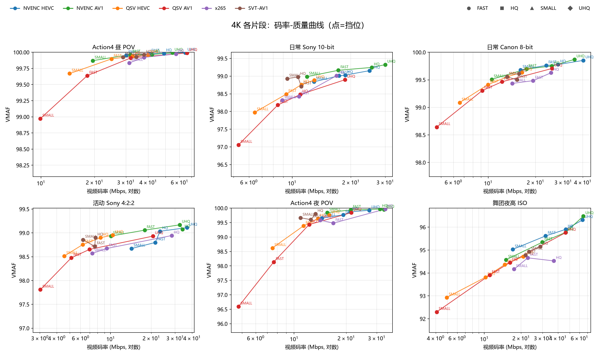
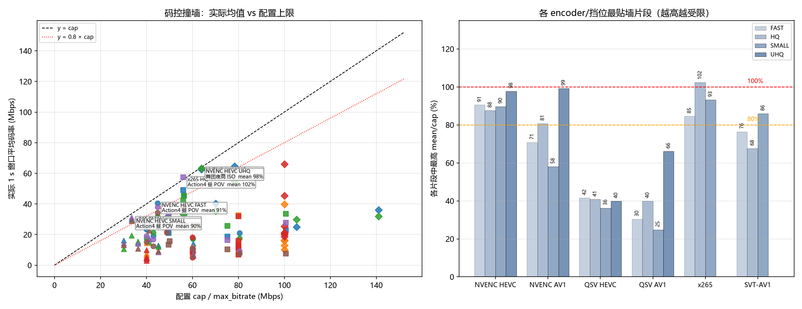
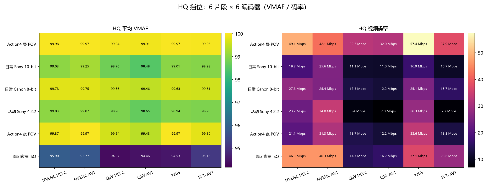
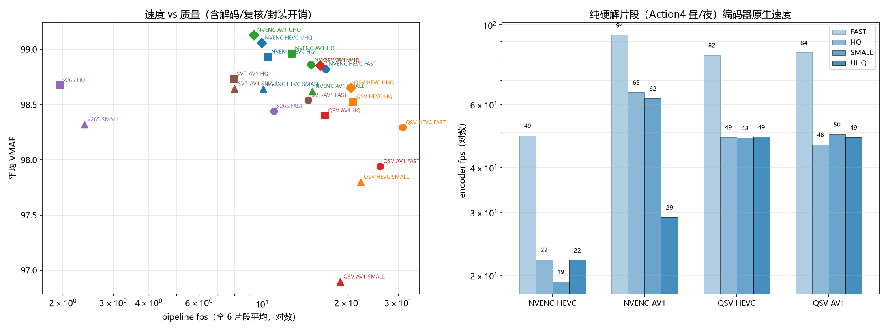

# 4K 编码器评估总报告（硬件全矩阵 + x265 / SVT-AV1）

本报告汇总三组测试：

1. **硬件全矩阵**：4 硬件编码器 × 4 挡位 × 6 条 30 s 片段（96 输出，2.6 h）→ `work/hw4k_matrix/REPORT.md`
2. **x265**：FAST/HQ/SMALL 6 片段 + UHQ 2×10 s→ `work/software_eval/REPORT.md`
3. **SVT-AV1**：FAST/HQ/SMALL 6 片段（UHQ 实测不可行）→ `work/software_eval/REPORT.md`

## 素材

* Action4 夜 POV（4K 4:3 10-bit HEVC）、舞团夜高 ISO（4K60 10-bit HEVC）
* Action4 昼 POV、202610 白天（Sony 10-bit HEVC / Canon 8-bit H.264）
* I:\2026.09.24 活动（Sony 4:2:2 10-bit H.264）

## 核心结论

1. **速度**：NVENC 最快（FAST 硬解片段 49–94 encoder fps），QSV 次之（48–84）；x265 FAST 5.8–14.3，x265 HQ 0.7–3.1；SVT-AV1 FAST 3.3–23，HQ 2.6–12；x265 UHQ ~0.24 fps、SVT UHQ ~0.02 fps，4K 重挡位不可生产。
2. **画质/码率**：UHQ/HQ 最高 VMAF 为 NVENC AV1（99.13/98.96），NVENC HEVC 紧随；QSV 码率显著更低但画质也更低。
3. **软件效率**：x265 FAST 用 0.44–0.93× NVENC HEVC 的码率达到接近画质；SVT-AV1 FAST/HQ 用 0.33–0.84× 码率达到接近/相当画质，但速度慢 3–10 倍（相对硬件）。
4. **撞墙**：硬件侧 NVENC 在 4K 高复杂度场景（舞团夜、Action4 昼）顶到动态 VBV cap（mean/cap 82–99%）；QSV 全部未撞。软件侧 x265 HQ 在 Action4 昼也触顶（103%），x265 UHQ 短样本 106%，SVT SMALL 86%。
5. **推荐**：批量/实时 4K 用 NVENC HEVC FAST/HQ；追求码率效率且能离线跑可用 SVT-AV1 HQ（比 x265 HQ 快、效率好），但要接受 4–10 倍时间；x265 UHQ 4K 不建议。

## 硬件全矩阵摘要（全片段平均，Mbps / VMAF）

| Encoder | UHQ | HQ | SMALL | FAST |
|---|---|---|---|---|
| NVENC HEVC | 42.9 / 99.06 | 31.0 / 98.93 | 17.5 / 98.64 | 25.6 / 98.82 |
| NVENC AV1 | 41.7 / 99.13 | 34.1 / 98.96 | 13.8 / 98.62 | 22.6 / 98.86 |
| QSV HEVC | 19.4 / 98.65 | 15.7 / 98.53 | 7.4 / 97.80 | 12.0 / 98.29 |
| QSV AV1 | 33.1 / 98.85 | 15.1 / 98.40 | 5.3 / 96.90 | 9.9 / 97.94 |

## 软件摘要（完整 30 s 平均，Mbps / VMAF / pipeline fps）

| Encoder | UHQ | HQ | SMALL | FAST |
|---|---|---|---|---|
| x265 | — | 33.1 / 98.68 / 2.0 | 15.6 / 98.32 / 2.4 | 19.5 / 98.44 / 11.0 |
| SVT-AV1 | — | 19.0 / 98.73 / 7.9 | 15.3 / 98.64 / 8.0 | 17.1 / 98.54 / 14.5 |

## 图表包

图表索引：`work/charts/REPORT_CHARTS.md`

* 
* 
* 
* 
* 全部 8 张图的 PDF：`work/charts/4K评估图表合集.pdf`
* 缩略总览：`work/charts/00_contact_sheet.png`

## 文件

* 硬件矩阵：`work/hw4k_matrix/REPORT.md` / `metrics.csv`；原始输出 `runs/`
* 软件矩阵：`work/software_eval/REPORT.md` / `metrics_software.csv`；原始输出 `work/sw4k_matrix/runs/`、`work/svt4k_matrix/runs/`
* 只读切片：`work/hw4k_matrix/clips/`（6×30 s）+ `extra_clips/`（9 条备用素材）
* 码控撞墙明细：`work/hw4k_matrix/rc_wall.txt`

