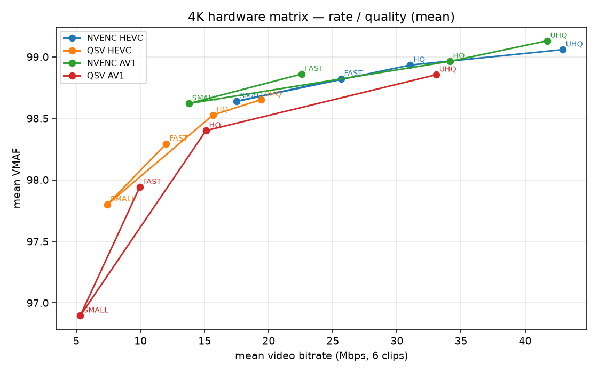
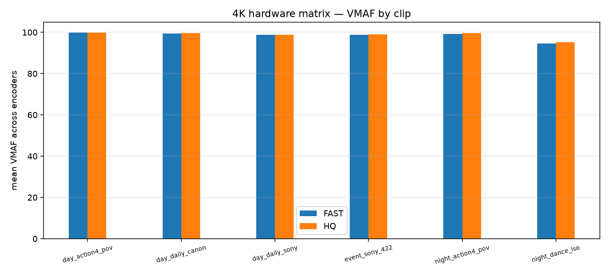

> 全量总报告（含 x265 / SVT-AV1 软件对照）：`REPORT_4K_EVALUATION.md`

# 4K 原生 硬件编码器全矩阵（30 s 多场景）

4 个硬件编码器 × UHQ/HQ/SMALL/FAST × 6 条 30 s 只读切片（夜/昼/活动）。

## 测试素材（只读源切片，30 s）

| 片段 | 来源 | 分辨率 | 编码 | fps | 源码率 Mbps |
|---|---|---|---|---|---|
| day_action4_pov | 昼 | 3840×2880 | hevc/yuv420p10le | 29.97 | 112.0 |
| day_daily_canon | 昼 | 3840×2160 | h264/yuv420p | 29.97 | 100.2 |
| day_daily_sony | 昼 | 3840×2160 | hevc/yuv420p10le | 59.97 | 150.4 |
| event_sony_422 | 昼 | 3840×2160 | h264/yuv422p10le | 50.03 | 201.4 |
| night_action4_pov | 夜 | 3840×2880 | hevc/yuv420p10le | 29.97 | 66.1 |
| night_dance_iso | 夜 | 3840×2160 | hevc/yuv420p10le | 59.94 | 75.1 |

### 解码路径与编码格式（重要）

| 片段 | 软件解码回退的编码器 | 原因/说明 |
|---|---|---|
| day_daily_canon | nvenc, nvenc-av1, qsv, qsv-av1 | 硬件解码完整性校验未通过/不支持 → avsw 软件解码；只影响该片段的速度，不影响码率/画质 |
| day_daily_sony | nvenc, nvenc-av1, qsv, qsv-av1 | 硬件解码完整性校验未通过/不支持 → avsw 软件解码；只影响该片段的速度，不影响码率/画质 |
| event_sony_422 | nvenc, nvenc-av1, qsv, qsv-av1 | 硬件解码完整性校验未通过/不支持 → avsw 软件解码；只影响该片段的速度，不影响码率/画质 |
| night_dance_iso | nvenc, nvenc-av1, qsv, qsv-av1 | 硬件解码完整性校验未通过/不支持 → avsw 软件解码；只影响该片段的速度，不影响码率/画质 |

* Action4 两条片段（30 fps HEVC）全程硬件解码；其余 4 条片段在 4 个硬件编码器上都退到软件解码。
* QSV 对 `event_sony_422`（H.264 4:2:2 10-bit）编码时降为 4:2:0/10；NVENC HEVC 保留 4:2:2/10。
* `day_daily_canon` 是 8-bit H.264 源：NVENC/QSV 的 HEVC 输出为 4:2:0/8。
* 因此**速度横向比较以 Action4 两条硬解片段为准**；其余片段的速度受软件解码限制，不能代表编码器本身。

## day_action4_pov

| Encoder | UHQ | HQ | SMALL | FAST |
|---|---|---|---|---|
| NVENC HEVC | 64.7 Mb / VMAF 99.99 / 9 fps | 49.1 Mb / VMAF 99.98 / 10 fps | 30.2 Mb / VMAF 99.96 / 10 fps | 40.6 Mb / VMAF 99.98 / 13 fps |
| QSV HEVC | 39.9 Mb / VMAF 99.96 / 13 fps | 32.6 Mb / VMAF 99.94 / 14 fps | 14.5 Mb / VMAF 99.67 / 17 fps | 24.9 Mb / VMAF 99.90 / 17 fps |
| NVENC AV1 | 54.8 Mb / VMAF 99.99 / 8 fps | 42.1 Mb / VMAF 99.97 / 10 fps | 19.5 Mb / VMAF 99.87 / 12 fps | 31.8 Mb / VMAF 99.96 / 11 fps |
| QSV AV1 | 66.1 Mb / VMAF 99.99 / 7 fps | 32.0 Mb / VMAF 99.91 / 9 fps | 9.9 Mb / VMAF 98.97 / 12 fps | 18.2 Mb / VMAF 99.64 / 12 fps |

## day_daily_canon

| Encoder | UHQ | HQ | SMALL | FAST |
|---|---|---|---|---|
| NVENC HEVC | 40.3 Mb / VMAF 99.85 / 9 fps | 27.8 Mb / VMAF 99.78 / 9 fps | 16.1 Mb / VMAF 99.68 / 9 fps | 23.4 Mb / VMAF 99.76 / 15 fps |
| QSV HEVC | 16.4 Mb / VMAF 99.64 / 12 fps | 13.3 Mb / VMAF 99.56 / 13 fps | 6.6 Mb / VMAF 99.09 / 14 fps | 10.0 Mb / VMAF 99.41 / 11 fps |
| NVENC AV1 | 35.4 Mb / VMAF 99.87 / 9 fps | 25.4 Mb / VMAF 99.75 / 12 fps | 10.5 Mb / VMAF 99.51 / 15 fps | 17.5 Mb / VMAF 99.70 / 14 fps |
| QSV AV1 | 25.5 Mb / VMAF 99.71 / 9 fps | 12.2 Mb / VMAF 99.46 / 10 fps | 4.7 Mb / VMAF 98.64 / 12 fps | 9.2 Mb / VMAF 99.31 / 13 fps |

## day_daily_sony

| Encoder | UHQ | HQ | SMALL | FAST |
|---|---|---|---|---|
| NVENC HEVC | 25.0 Mb / VMAF 99.15 / 10 fps | 18.7 Mb / VMAF 99.03 / 11 fps | 12.9 Mb / VMAF 98.84 / 10 fps | 17.4 Mb / VMAF 99.01 / 19 fps |
| QSV HEVC | 13.0 Mb / VMAF 98.89 / 17 fps | 11.1 Mb / VMAF 98.76 / 17 fps | 6.4 Mb / VMAF 97.98 / 18 fps | 9.3 Mb / VMAF 98.49 / 23 fps |
| NVENC AV1 | 30.0 Mb / VMAF 99.32 / 10 fps | 25.6 Mb / VMAF 99.25 / 15 fps | 11.9 Mb / VMAF 98.99 / 17 fps | 17.3 Mb / VMAF 99.16 / 17 fps |
| QSV AV1 | 18.7 Mb / VMAF 98.90 / 13 fps | 11.0 Mb / VMAF 98.48 / 13 fps | 5.3 Mb / VMAF 97.06 / 14 fps | 8.4 Mb / VMAF 98.18 / 16 fps |

## event_sony_422

| Encoder | UHQ | HQ | SMALL | FAST |
|---|---|---|---|---|
| NVENC HEVC | 36.7 Mb / VMAF 99.11 / 10 fps | 23.2 Mb / VMAF 99.03 / 10 fps | 14.3 Mb / VMAF 98.67 / 9 fps | 21.4 Mb / VMAF 98.80 / 16 fps |
| QSV HEVC | 10.4 Mb / VMAF 98.96 / 45 fps | 8.4 Mb / VMAF 98.90 / 45 fps | 4.5 Mb / VMAF 98.52 / 45 fps | 6.2 Mb / VMAF 98.76 / 91 fps |
| NVENC AV1 | 32.5 Mb / VMAF 99.17 / 10 fps | 34.0 Mb / VMAF 99.07 / 13 fps | 10.1 Mb / VMAF 98.93 / 16 fps | 17.9 Mb / VMAF 99.06 / 17 fps |
| QSV AV1 | 20.6 Mb / VMAF 98.93 / 45 fps | 7.0 Mb / VMAF 98.65 / 43 fps | 3.0 Mb / VMAF 97.81 / 45 fps | 5.1 Mb / VMAF 98.48 / 85 fps |

## night_action4_pov

| Encoder | UHQ | HQ | SMALL | FAST |
|---|---|---|---|---|
| NVENC HEVC | 27.2 Mb / VMAF 99.93 / 12 fps | 21.1 Mb / VMAF 99.87 / 13 fps | 14.5 Mb / VMAF 99.66 / 12 fps | 19.3 Mb / VMAF 99.77 / 19 fps |
| QSV HEVC | 16.0 Mb / VMAF 99.76 / 18 fps | 13.7 Mb / VMAF 99.64 / 19 fps | 7.5 Mb / VMAF 98.62 / 21 fps | 11.3 Mb / VMAF 99.39 / 20 fps |
| NVENC AV1 | 33.1 Mb / VMAF 99.95 / 10 fps | 31.3 Mb / VMAF 99.97 / 12 fps | 15.5 Mb / VMAF 99.85 / 14 fps | 21.3 Mb / VMAF 99.94 / 14 fps |
| QSV AV1 | 21.4 Mb / VMAF 99.84 / 11 fps | 12.2 Mb / VMAF 99.43 / 12 fps | 4.8 Mb / VMAF 96.59 / 14 fps | 7.6 Mb / VMAF 98.14 / 13 fps |

## night_dance_iso

| Encoder | UHQ | HQ | SMALL | FAST |
|---|---|---|---|---|
| NVENC HEVC | 63.6 Mb / VMAF 96.31 / 10 fps | 46.3 Mb / VMAF 95.90 / 10 fps | 17.1 Mb / VMAF 95.03 / 10 fps | 31.7 Mb / VMAF 95.62 / 19 fps |
| QSV HEVC | 20.9 Mb / VMAF 94.72 / 17 fps | 14.7 Mb / VMAF 94.37 / 17 fps | 4.9 Mb / VMAF 92.93 / 19 fps | 10.2 Mb / VMAF 93.81 / 24 fps |
| NVENC AV1 | 64.5 Mb / VMAF 96.48 / 10 fps | 46.3 Mb / VMAF 95.77 / 14 fps | 15.1 Mb / VMAF 94.58 / 17 fps | 29.9 Mb / VMAF 95.34 / 16 fps |
| QSV AV1 | 46.2 Mb / VMAF 95.76 / 11 fps | 16.2 Mb / VMAF 94.46 / 13 fps | 4.1 Mb / VMAF 92.30 / 15 fps | 11.1 Mb / VMAF 93.91 / 17 fps |

## 全片段平均（码率 / VMAF / pipeline fps）

| Encoder | Preset | 视频 Mbps | VMAF | PSNR | SSIM | pipeline fps | encoder fps |
|---|---|---|---|---|---|---|---|
| NVENC HEVC | UHQ | 42.93 | 99.058 | 46.81 | 0.98797 | 9.9 | 22.1 |
| NVENC HEVC | HQ | 31.04 | 98.933 | 45.95 | 0.98600 | 10.5 | 22.1 |
| NVENC HEVC | SMALL | 17.51 | 98.639 | 44.79 | 0.98275 | 10.1 | 19.2 |
| NVENC HEVC | FAST | 25.64 | 98.822 | 45.56 | 0.98498 | 16.7 | 49.2 |
| QSV HEVC | UHQ | 19.41 | 98.652 | 44.80 | 0.98323 | 20.4 | 48.7 |
| QSV HEVC | HQ | 15.66 | 98.528 | 44.35 | 0.98186 | 20.8 | 48.7 |
| QSV HEVC | SMALL | 7.41 | 97.800 | 42.65 | 0.97584 | 22.1 | 48.4 |
| QSV HEVC | FAST | 12.01 | 98.293 | 43.69 | 0.97979 | 31.1 | 82.5 |
| NVENC AV1 | UHQ | 41.71 | 99.130 | 47.22 | 0.98904 | 9.3 | 29.1 |
| NVENC AV1 | HQ | 34.13 | 98.963 | 46.47 | 0.98768 | 12.7 | 64.9 |
| NVENC AV1 | SMALL | 13.77 | 98.620 | 44.49 | 0.98211 | 15.0 | 62.5 |
| NVENC AV1 | FAST | 22.58 | 98.860 | 45.60 | 0.98509 | 14.8 | 93.8 |
| QSV AV1 | UHQ | 33.06 | 98.854 | 46.17 | 0.98693 | 15.9 | 48.6 |
| QSV AV1 | HQ | 15.10 | 98.400 | 44.43 | 0.98226 | 16.6 | 46.4 |
| QSV AV1 | SMALL | 5.30 | 96.896 | 41.89 | 0.97232 | 18.8 | 49.6 |
| QSV AV1 | FAST | 9.94 | 97.941 | 43.36 | 0.97901 | 25.9 | 83.8 |

## 纯硬解速度（仅 Action4 夜/昼 POV，avhw）

| Encoder | Preset | pipeline fps | encoder fps |
|---|---|---|---|
| NVENC HEVC | UHQ | 10.8 | 22.1 |
| NVENC HEVC | HQ | 11.4 | 22.1 |
| NVENC HEVC | SMALL | 11.1 | 19.2 |
| NVENC HEVC | FAST | 15.9 | 49.2 |
| QSV HEVC | UHQ | 15.9 | 48.7 |
| QSV HEVC | HQ | 16.4 | 48.7 |
| QSV HEVC | SMALL | 18.7 | 48.4 |
| QSV HEVC | FAST | 18.5 | 82.5 |
| NVENC AV1 | UHQ | 8.7 | 29.1 |
| NVENC AV1 | HQ | 10.9 | 64.9 |
| NVENC AV1 | SMALL | 12.8 | 62.5 |
| NVENC AV1 | FAST | 12.4 | 93.8 |
| QSV AV1 | UHQ | 9.0 | 48.6 |
| QSV AV1 | HQ | 10.2 | 46.4 |
| QSV AV1 | SMALL | 13.1 | 49.6 |
| QSV AV1 | FAST | 12.5 | 83.8 |

## 夜景 vs 白天（全片段平均）

| Encoder | Preset | 夜 Mbps/VMAF | 昼 Mbps/VMAF |
|---|---|---|---|
| NVENC HEVC | UHQ | 45.4/98.12 | 41.7/99.53 |
| NVENC HEVC | HQ | 33.7/97.89 | 29.7/99.46 |
| NVENC HEVC | SMALL | 15.8/97.34 | 18.4/99.29 |
| NVENC HEVC | FAST | 25.5/97.69 | 25.7/99.39 |
| QSV HEVC | UHQ | 18.4/97.24 | 19.9/99.36 |
| QSV HEVC | HQ | 14.2/97.00 | 16.4/99.29 |
| QSV HEVC | SMALL | 6.2/95.78 | 8.0/98.81 |
| QSV HEVC | FAST | 10.8/96.60 | 12.6/99.14 |
| NVENC AV1 | UHQ | 48.8/98.21 | 38.2/99.59 |
| NVENC AV1 | HQ | 38.8/97.87 | 31.8/99.51 |
| NVENC AV1 | SMALL | 15.3/97.21 | 13.0/99.32 |
| NVENC AV1 | FAST | 25.6/97.64 | 21.1/99.47 |
| QSV AV1 | UHQ | 33.8/97.80 | 32.7/99.38 |
| QSV AV1 | HQ | 14.2/96.94 | 15.5/99.13 |
| QSV AV1 | SMALL | 4.4/94.45 | 5.7/98.12 |
| QSV AV1 | FAST | 9.4/96.02 | 10.2/98.90 |

## 码率控制撞墙（均值/峰值 vs cap）

按片段计算后汇总；判定看**任一片段**是否贴 cap。

| Encoder | Preset | 平均 mean/cap | 最高 mean/cap | 最高 p95/cap | 最高峰值/cap | 撞墙片段数 | 判定 |
|---|---|---|---|---|---|---|---|
| NVENC HEVC | UHQ | 56% | 98% | 104% | 107% | 2 | 撞墙 |
| NVENC HEVC | HQ | 52% | 88% | 103% | 110% | 2 | 撞墙 |
| NVENC HEVC | SMALL | 46% | 90% | 107% | 111% | 1 | 撞墙 |
| NVENC HEVC | FAST | 52% | 91% | 106% | 114% | 1 | 撞墙 |
| QSV HEVC | UHQ | 19% | 40% | 54% | 56% | 0 | 未撞 |
| QSV HEVC | HQ | 19% | 41% | 56% | 57% | 0 | 未撞 |
| QSV HEVC | SMALL | 18% | 36% | 50% | 54% | 0 | 未撞 |
| QSV HEVC | FAST | 20% | 42% | 55% | 61% | 0 | 未撞 |
| NVENC AV1 | UHQ | 55% | 99% | 125% | 127% | 1 | 撞墙 |
| NVENC AV1 | HQ | 56% | 81% | 97% | 97% | 1 | 撞墙 |
| NVENC AV1 | SMALL | 36% | 58% | 74% | 77% | 0 | 未撞 |
| NVENC AV1 | FAST | 46% | 71% | 83% | 85% | 0 | 接近 |
| QSV AV1 | UHQ | 33% | 66% | 98% | 110% | 0 | 接近 |
| QSV AV1 | HQ | 19% | 40% | 63% | 74% | 0 | 未撞 |
| QSV AV1 | SMALL | 13% | 25% | 36% | 43% | 0 | 未撞 |
| QSV AV1 | FAST | 16% | 30% | 46% | 54% | 0 | 未撞 |

撞墙明细（mean/cap≥80%）：

* night_dance_iso / NVENC AV1 / UHQ: mean 99% / p95 125% / peak 127%
* night_dance_iso / NVENC HEVC / UHQ: mean 98% / p95 104% / peak 107%
* day_action4_pov / NVENC HEVC / FAST: mean 91% / p95 106% / peak 114%
* day_action4_pov / NVENC HEVC / SMALL: mean 90% / p95 107% / peak 111%
* day_action4_pov / NVENC HEVC / HQ: mean 88% / p95 103% / peak 110%
* day_action4_pov / NVENC HEVC / UHQ: mean 82% / p95 96% / peak 101%
* night_dance_iso / NVENC AV1 / HQ: mean 81% / p95 97% / peak 97%
* night_dance_iso / NVENC HEVC / HQ: mean 81% / p95 92% / peak 98%

## 主要发现

* UHQ 全片段平均 VMAF 最高：NVENC AV1 (99.130)；最低：QSV HEVC (98.652)。
* HQ 全片段平均 VMAF 最高：NVENC AV1 (98.963)；最低：QSV AV1 (98.400)。
* SMALL 全片段平均 VMAF 最高：NVENC HEVC (98.639)；最低：QSV AV1 (96.896)。
* FAST 全片段平均 VMAF 最高：NVENC AV1 (98.860)；最低：QSV AV1 (97.941)。
* UHQ 全片段平均码率最低：QSV HEVC (19.4 Mbps)；最高：NVENC HEVC (42.9 Mbps)。
* HQ 全片段平均码率最低：QSV AV1 (15.1 Mbps)；最高：NVENC AV1 (34.1 Mbps)。
* SMALL 全片段平均码率最低：QSV AV1 (5.3 Mbps)；最高：NVENC HEVC (17.5 Mbps)。
* FAST 全片段平均码率最低：QSV AV1 (9.9 Mbps)；最高：NVENC HEVC (25.6 Mbps)。
* NVENC HQ：AV1 相对 HEVC 码率 110%，VMAF 98.963 vs 98.933。
* HQ：QSV HEVC 相对 NVENC HEVC 码率 50%，VMAF 98.528 vs 98.933。
* 按片段 mean/cap≥80% 的格子共 8 个。
  * night_dance_iso / nvenc-av1 / uhq: mean/cap≈99%，p95/cap≈125%，peak/cap≈127%
  * night_dance_iso / nvenc / uhq: mean/cap≈98%，p95/cap≈104%，peak/cap≈107%
  * day_action4_pov / nvenc / fast: mean/cap≈91%，p95/cap≈106%，peak/cap≈114%
  * day_action4_pov / nvenc / small: mean/cap≈90%，p95/cap≈107%，peak/cap≈111%
  * day_action4_pov / nvenc / hq: mean/cap≈88%，p95/cap≈103%，peak/cap≈110%
  * day_action4_pov / nvenc / uhq: mean/cap≈82%，p95/cap≈96%，peak/cap≈101%
  * night_dance_iso / nvenc-av1 / hq: mean/cap≈81%，p95/cap≈97%，peak/cap≈97%
  * night_dance_iso / nvenc / hq: mean/cap≈81%，p95/cap≈92%，peak/cap≈98%

## 图表

## 方法学与限制

* 6 条 30 s 只读切片：Action4 夜 POV、舞团夜高 ISO、Action4 昼 POV、202610 白天（Sony 10-bit / Canon 8-bit）、I:2026.09.24 活动（Sony 4:2:2 10-bit）。
* 4 硬件编码器 × 4 挡位；每作业一次处理 6 条片段。
* 画质：全片段（30 s）VMAF/PSNR/SSIM，1280 宽等比缩放，硬件解码。
* 码率：仅视频包；cap 来自 1kt 产品日志（NVENC 动态 VBV、QSV 静态表）。
* 速度：encoder fps 来自编码器自身日志；pipeline fps 含探测/复核/封装开销。
* 片段来自真实素材的不同卷/相机；分辨率/编码/fps 不同（4:3 与 16:9、8/10-bit、4:2:2），横向比较以“同片段内相对排序”为主。
* 本矩阵只覆盖硬件编码器；x265/SVT-AV1 软件编码另测（4K 软件极慢）。

