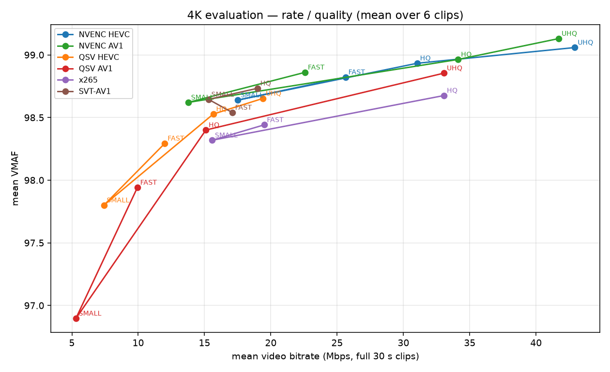
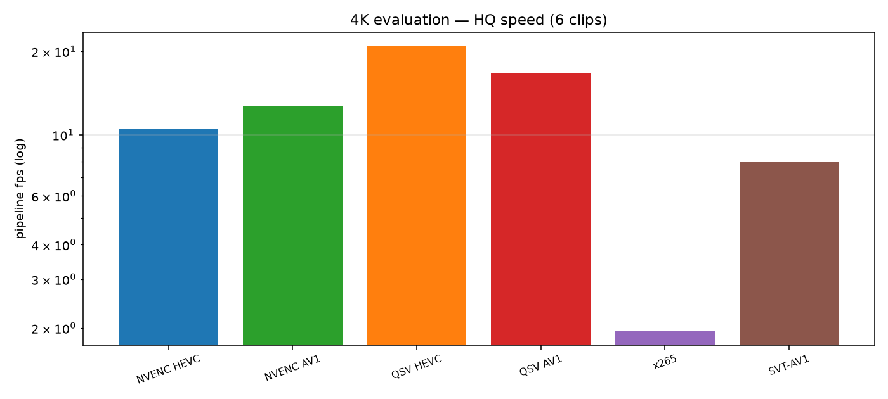

# 4K 软件编码器评估：x265 / SVT-AV1（30 s 多场景）

与 `work/hw4k_matrix` 硬件矩阵使用同一批 6 条 30 s 只读切片。

## 范围与限制（先看）

* x265：FAST/HQ/SMALL 完整 6 片段；**UHQ 仅 2 条 10 s 片段**（4K UHQ 实测约 0.24 fps，6×30 s 估算 >6 h，无法在窗口内完成）。
* SVT-AV1：FAST/HQ/SMALL 完整 6 片段；**UHQ 未完成**（实测约 1 帧/50 s ≈ 0.02 fps，10 s 2 片段也需 >4 h）。
* 因此软件重挡位的码率/画质只作趋势参考，不与 30 s 完整片段直接比较。
* 软件编码使用产品默认参数；x265 为 `slow`（HQ/UHQ/SMALL 同一 preset，不同 CRF/质量参数）。

## 软件矩阵逐片段结果（30 s 完整片段）

### day_action4_pov

| Encoder | UHQ | HQ | SMALL | FAST |
|---|---|---|---|---|
| x265 | 91.3 Mb / VMAF 99.98 / 10 s | 57.4 Mb / VMAF 99.97 / 0.8 fps | 31.3 Mb / VMAF 99.84 / 0.9 fps | 37.9 Mb / VMAF 99.92 / 5.9 fps |
| SVT-AV1 | — | 37.9 Mb / VMAF 99.96 / 4.4 fps | 28.9 Mb / VMAF 99.92 / 4.6 fps | 34.3 Mb / VMAF 99.93 / 7.0 fps |

### day_daily_canon

| Encoder | UHQ | HQ | SMALL | FAST |
|---|---|---|---|---|
| x265 | — | 25.1 Mb / VMAF 99.63 / 3.1 fps | 14.2 Mb / VMAF 99.43 / 3.0 fps | 19.3 Mb / VMAF 99.48 / 14.5 fps |
| SVT-AV1 | — | 15.7 Mb / VMAF 99.61 / 9.9 fps | 13.2 Mb / VMAF 99.55 / 9.8 fps | 15.3 Mb / VMAF 99.50 / 21.9 fps |

### day_daily_sony

| Encoder | UHQ | HQ | SMALL | FAST |
|---|---|---|---|---|
| x265 | — | 16.9 Mb / VMAF 99.01 / 2.6 fps | 8.9 Mb / VMAF 98.32 / 2.5 fps | 10.9 Mb / VMAF 98.43 / 12.9 fps |
| SVT-AV1 | — | 10.7 Mb / VMAF 98.98 / 7.6 fps | 9.4 Mb / VMAF 98.93 / 7.7 fps | 11.1 Mb / VMAF 98.71 / 11.0 fps |

### event_sony_422

| Encoder | UHQ | HQ | SMALL | FAST |
|---|---|---|---|---|
| x265 | — | 28.3 Mb / VMAF 98.94 / 1.8 fps | 7.3 Mb / VMAF 98.57 / 2.6 fps | 9.4 Mb / VMAF 98.67 / 11.1 fps |
| SVT-AV1 | — | 7.7 Mb / VMAF 98.90 / 12.0 fps | 6.3 Mb / VMAF 98.86 / 12.2 fps | 7.6 Mb / VMAF 98.72 / 23.0 fps |

### night_action4_pov

| Encoder | UHQ | HQ | SMALL | FAST |
|---|---|---|---|---|
| x265 | 46.0 Mb / VMAF 99.98 / 10 s | 33.6 Mb / VMAF 99.97 / 0.7 fps | 14.2 Mb / VMAF 99.58 / 0.9 fps | 16.9 Mb / VMAF 99.48 / 7.2 fps |
| SVT-AV1 | — | 13.3 Mb / VMAF 99.80 / 2.6 fps | 10.9 Mb / VMAF 99.67 / 2.7 fps | 12.5 Mb / VMAF 99.60 / 3.3 fps |

### night_dance_iso

| Encoder | UHQ | HQ | SMALL | FAST |
|---|---|---|---|---|
| x265 | — | 37.1 Mb / VMAF 94.53 / 2.7 fps | 17.5 Mb / VMAF 94.17 / 4.4 fps | 22.7 Mb / VMAF 94.66 / 14.3 fps |
| SVT-AV1 | — | 28.6 Mb / VMAF 95.15 / 11.1 fps | 23.2 Mb / VMAF 94.93 / 11.0 fps | 21.8 Mb / VMAF 94.78 / 20.9 fps |

## 全片段平均（完整 30 s，x265 UHQ 除外）

| Encoder | Preset | 视频 Mbps | VMAF | PSNR | SSIM | pipeline fps |
|---|---|---|---|---|---|---|
| x265 | HQ | 33.06 | 98.675 | 44.84 | 0.98575 | 2.0 |
| x265 | SMALL | 15.57 | 98.318 | 43.67 | 0.98232 | 2.4 |
| x265 | FAST | 19.49 | 98.441 | 43.71 | 0.98183 | 11.0 |
| SVT-AV1 | HQ | 18.99 | 98.733 | 44.46 | 0.98426 | 7.9 |
| SVT-AV1 | SMALL | 15.30 | 98.645 | 44.09 | 0.98338 | 8.0 |
| SVT-AV1 | FAST | 17.10 | 98.540 | 44.00 | 0.98305 | 14.5 |

x265 UHQ 短样本（2×10 s，仅趋势）：day_action4_pov 91.3 Mbps / VMAF 99.982；night_action4_pov 46.0 Mbps / VMAF 99.975

## 与硬件编码器对照（FAST / HQ，视频 Mbps / VMAF）

### FAST

| 片段 | NVENC HEVC | NVENC AV1 | QSV HEVC | QSV AV1 | x265 | SVT-AV1 |
|---|---|---|---|---|---|---|
| day_action4_pov | 40.6 / 99.98 | 31.8 / 99.96 | 24.9 / 99.90 | 18.2 / 99.64 | 37.9 / 99.92 | 34.3 / 99.93 |
| day_daily_canon | 23.4 / 99.76 | 17.5 / 99.70 | 10.0 / 99.41 | 9.2 / 99.31 | 19.3 / 99.48 | 15.3 / 99.50 |
| day_daily_sony | 17.4 / 99.01 | 17.3 / 99.16 | 9.3 / 98.49 | 8.4 / 98.18 | 10.9 / 98.43 | 11.1 / 98.71 |
| event_sony_422 | 21.4 / 98.80 | 17.9 / 99.06 | 6.2 / 98.76 | 5.1 / 98.48 | 9.4 / 98.67 | 7.6 / 98.72 |
| night_action4_pov | 19.3 / 99.77 | 21.3 / 99.94 | 11.3 / 99.39 | 7.6 / 98.14 | 16.9 / 99.48 | 12.5 / 99.60 |
| night_dance_iso | 31.7 / 95.62 | 29.9 / 95.34 | 10.2 / 93.81 | 11.1 / 93.91 | 22.7 / 94.66 | 21.8 / 94.78 |

### HQ

| 片段 | NVENC HEVC | NVENC AV1 | QSV HEVC | QSV AV1 | x265 | SVT-AV1 |
|---|---|---|---|---|---|---|
| day_action4_pov | 49.1 / 99.98 | 42.1 / 99.97 | 32.6 / 99.94 | 32.0 / 99.91 | 57.4 / 99.97 | 37.9 / 99.96 |
| day_daily_canon | 27.8 / 99.78 | 25.4 / 99.75 | 13.3 / 99.56 | 12.2 / 99.46 | 25.1 / 99.63 | 15.7 / 99.61 |
| day_daily_sony | 18.7 / 99.03 | 25.6 / 99.25 | 11.1 / 98.76 | 11.0 / 98.48 | 16.9 / 99.01 | 10.7 / 98.98 |
| event_sony_422 | 23.2 / 99.03 | 34.0 / 99.07 | 8.4 / 98.90 | 7.0 / 98.65 | 28.3 / 98.94 | 7.7 / 98.90 |
| night_action4_pov | 21.1 / 99.87 | 31.3 / 99.97 | 13.7 / 99.64 | 12.2 / 99.43 | 33.6 / 99.97 | 13.3 / 99.80 |
| night_dance_iso | 46.3 / 95.90 | 46.3 / 95.77 | 14.7 / 94.37 | 16.2 / 94.46 | 37.1 / 94.53 | 28.6 / 95.15 |

## 速度（pipeline fps，完整片段；越高越快）

| Encoder | UHQ | HQ | SMALL | FAST |
|---|---|---|---|---|
| NVENC HEVC | 9.9 | 10.5 | 10.1 | 16.7 |
| NVENC AV1 | 9.3 | 12.7 | 15.0 | 14.8 |
| QSV HEVC | 20.4 | 20.8 | 22.1 | 31.1 |
| QSV AV1 | 15.9 | 16.6 | 18.8 | 25.9 |
| x265 | 0.2–0.3（10 s 样本） | 2.0 | 2.4 | 11.0 |
| SVT-AV1 | — | 7.9 | 8.0 | 14.5 |

* x265 UHQ 4K 实测约 0.24 fps；SVT-AV1 UHQ 4K 实测约 0.02 fps。
* NVENC/QSV 编码器速度包含解码/复核/封装开销（pipeline fps）；纯硬解片段见硬件报告。

## 软件编码的码率上限（CRF + VBV）

mean/cap ≥80% 的格子：5 个。
* x265 / UHQ / day_action4_pov: mean/cap≈106%（cap 85.7 Mbps）
* x265 / HQ / day_action4_pov: mean/cap≈103%（cap 56.0 Mbps）
* x265 / SMALL / day_action4_pov: mean/cap≈93%（cap 33.6 Mbps）
* SVT-AV1 / SMALL / day_action4_pov: mean/cap≈86%（cap 33.6 Mbps）
* x265 / FAST / day_action4_pov: mean/cap≈85%（cap 44.8 Mbps）

## 主要发现

* FAST：码率最低 QSV AV1 (9.9 Mbps / VMAF 97.94)；VMAF 最高 NVENC AV1 (22.6 Mbps / 98.86)。
* HQ：码率最低 QSV AV1 (15.1 Mbps / VMAF 98.40)；VMAF 最高 NVENC AV1 (34.1 Mbps / 98.96)。
* SMALL：码率最低 QSV AV1 (5.3 Mbps / VMAF 96.90)；VMAF 最高 SVT-AV1 (15.3 Mbps / 98.64)。
* 软件编码（x265/SVT-AV1）在多数场景可用明显更低码率接近硬件编码画质，但速度慢 3–50 倍；4K 实时/批量生产仍应使用 NVENC/QSV。
* 夜间高 ISO 舞团片段对所有编码器都困难（VMAF 92–96）；SVT-AV1 HQ 在该片段上效率最好（28.6 Mbps / 95.15）。
* x265 重挡位在 4K 下不具生产可行性；x265 UHQ 的码率甚至触顶 VBV cap（day_action4_pov 106%）。

## 图表

