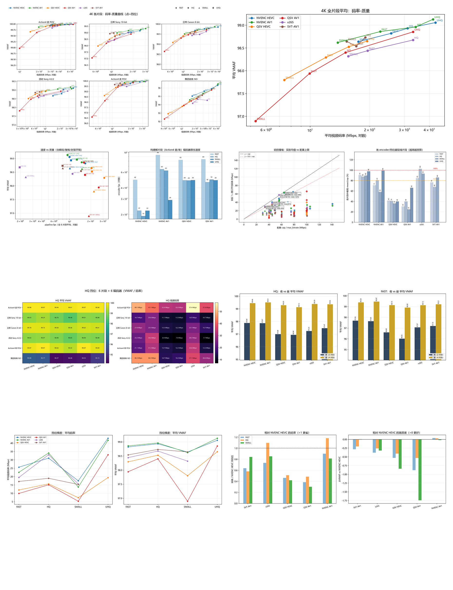
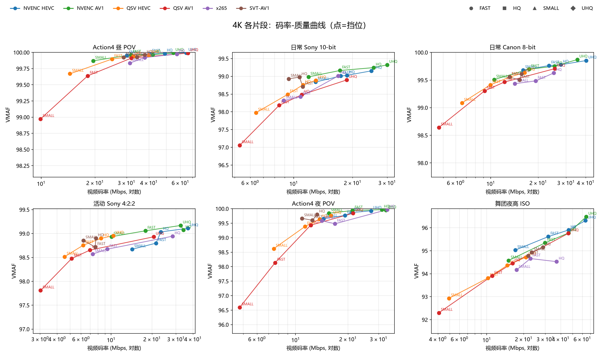
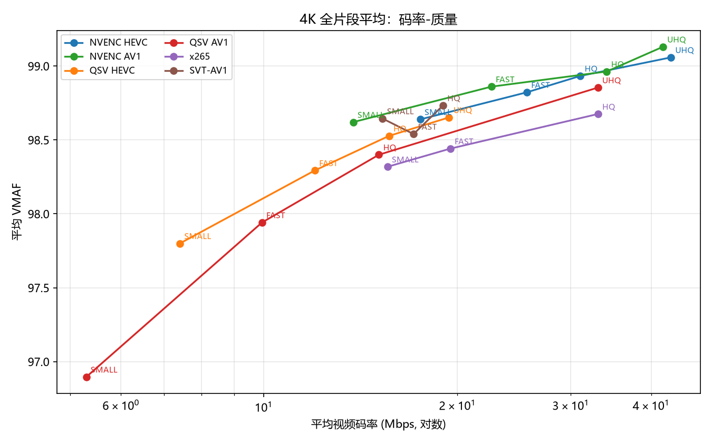
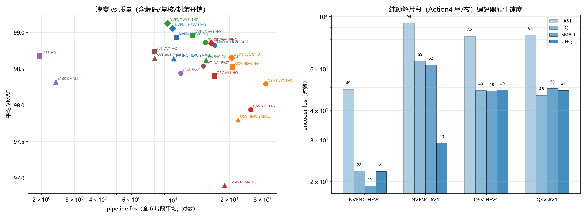
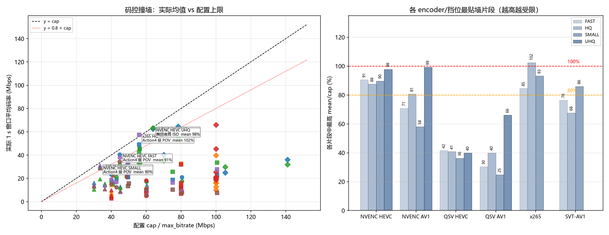
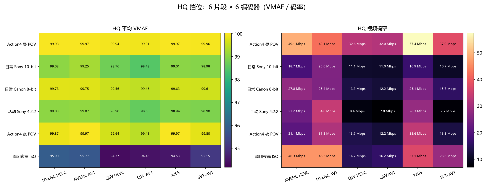
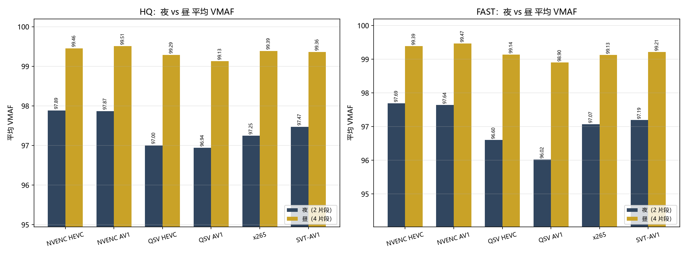
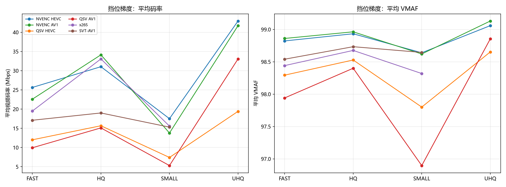
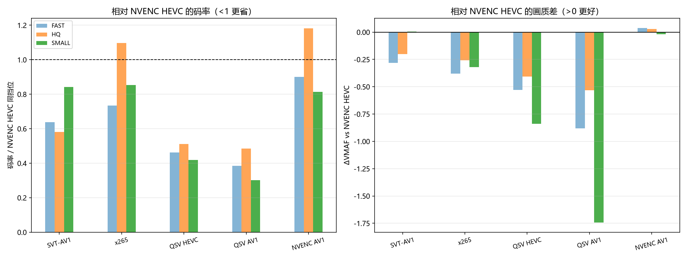

# 4K 评估图表包

数据源：硬件矩阵 96 输出 + x265 20 输出 + SVT-AV1 18 输出。
所有曲线使用完整 30 s 片段；x265 UHQ 10 s 样本不进入曲线。

* 图表合集 PDF：[`4K评估图表合集.pdf`](4K评估图表合集.pdf)
* 缩略总览：

## 各片段码率-质量曲线（6 编码器 × 挡位）

## 全片段平均码率-质量

## 速度-质量 & 纯硬解 encoder fps

## 码控撞墙（实际 vs cap）

## HQ 挡位 VMAF/码率热图

## 夜 vs 昼 VMAF（HQ/FAST）

## 挡位梯度（码率/VMAF）

## 相对 NVENC HEVC 的效率

