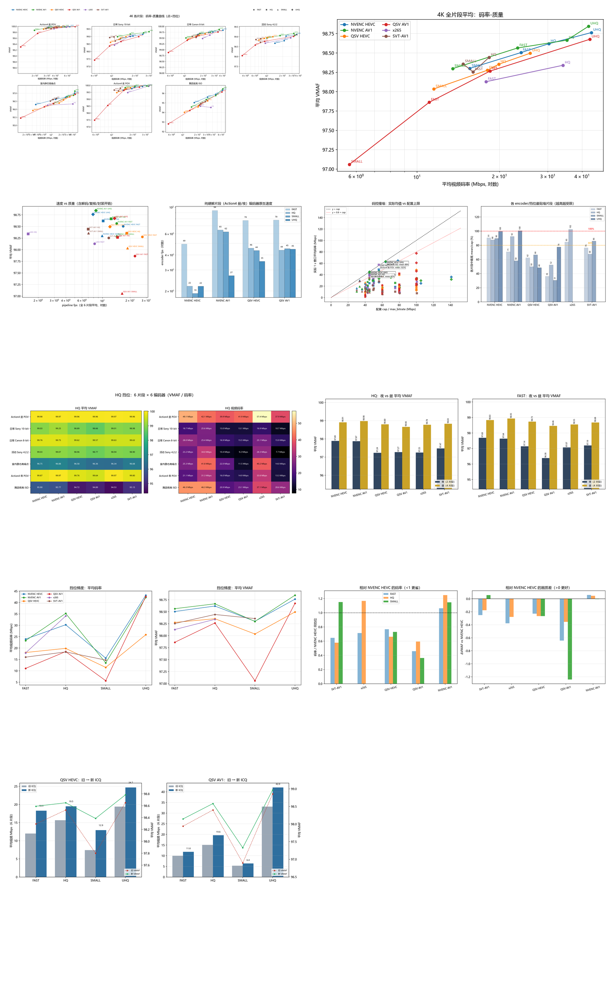
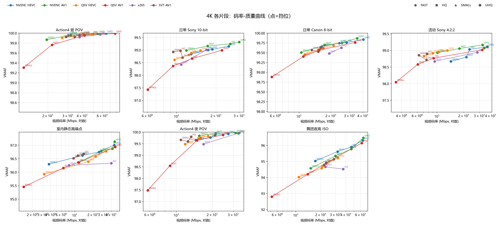
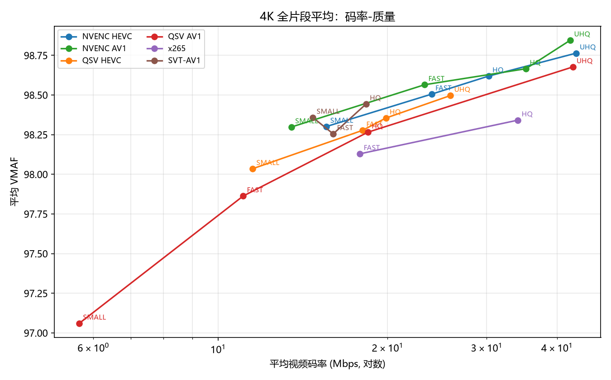
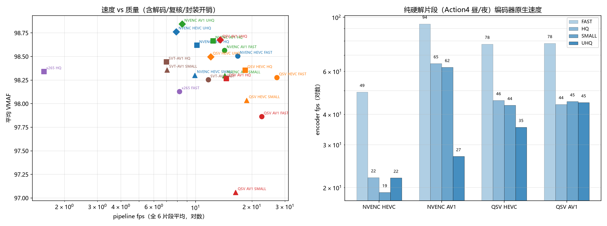
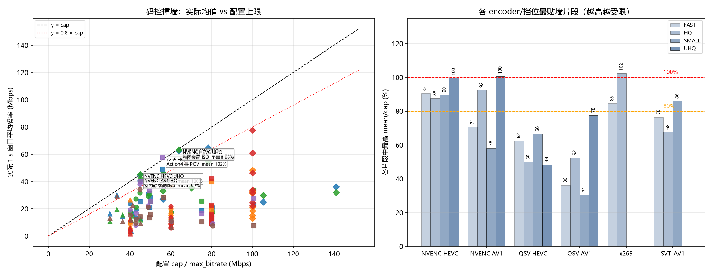
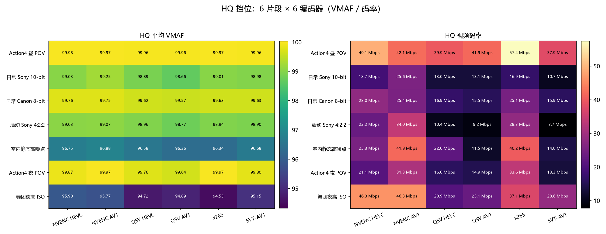
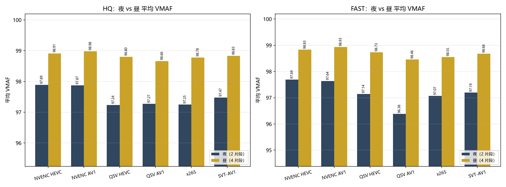
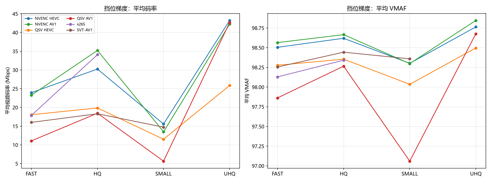
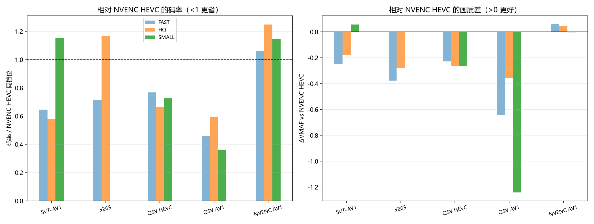
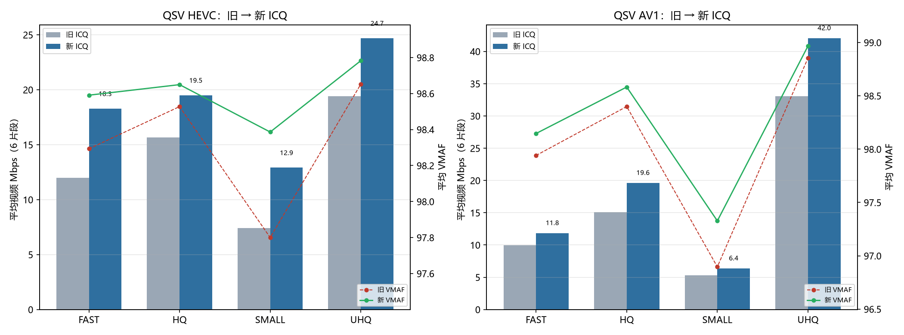

# 4K 评估图表包

数据源：硬件矩阵 112 输出（7 片段）+ 软件矩阵 35 输出（x265 14 / SVT-AV1 21）。

* 合集 PDF：[`4K_20261118图表合集.pdf`](4K_20261118图表合集.pdf)
* 缩略总览：
所有曲线使用完整 30 s 片段；x265 UHQ 10 s 样本不进入曲线。

## 各片段码率-质量曲线（6 编码器 × 挡位）

## 全片段平均码率-质量

## 速度-质量 & 纯硬解 encoder fps

## 码控撞墙（实际 vs cap）

## HQ 挡位 VMAF/码率热图

## 夜 vs 非夜 VMAF（HQ/FAST；含室内噪点）

## 挡位梯度（码率/VMAF）

## 相对 NVENC HEVC 的效率

## QSV ICQ 下调效果（旧→新）

## 重要注记（2026-11-18 肉眼复核）

- 夜间高噪点/颗粒场景，肉眼判断 **x265 明显优于 NVENC**；
- 01/02/05/08 等基于 VMAF 的图在噪点场景与肉眼排序不一致，VMAF 仅作参考；
- 归档选型以肉眼颗粒保真为准，不以本图包 VMAF 排名直接定案。
